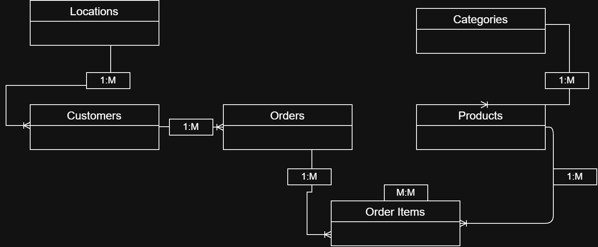
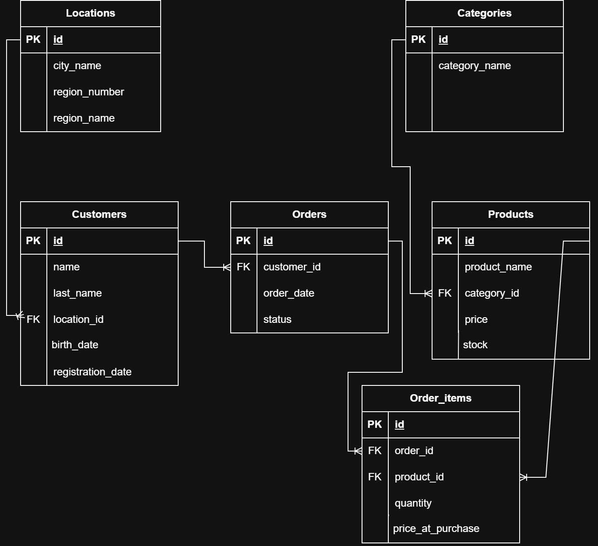
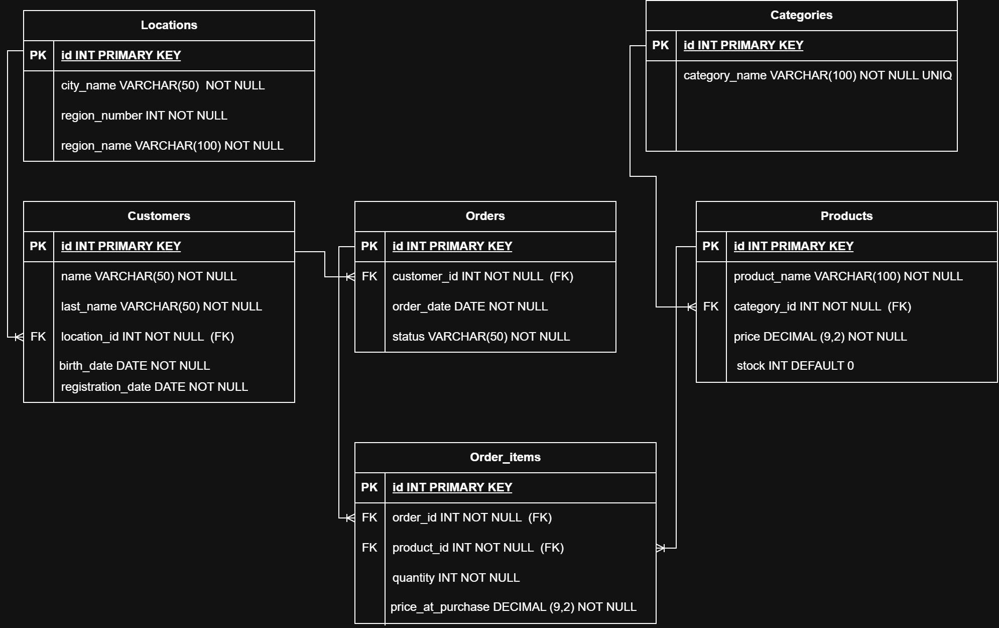
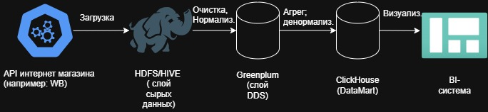
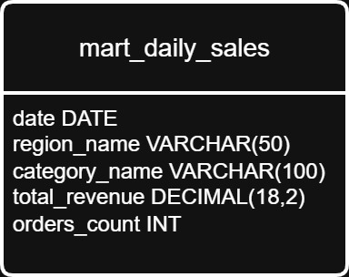
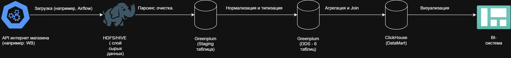

# Анализ ежедневной выручки по регионам для отдела маркетинга

Источник: API интернет магащина
Бизнес сценарий: Анализ ежедневной выручки по регионам для отдела маркетинга

## Концептуальная модель

- Locations - Таблица справочник с регионами, в которых интернет-магазин ведет свою деятельность. Связан с Customer(заказчик/покупатель) связью один ко многим (в одном регионе, много покупателей)
- Customers - Таблица с информацией о пользвателях интернет магазина. связана с таблицей Orders один ко сногим.
- Category - Таблица справочник с категориями товаров представленными на ммаркетплейсе. Связана связью один ко многим с таблицей Products.
- Products - Таблица с информацией о товарах размещенных на маркет плейсе.
- Orders - Таблица с информацией о созаднном заказе.
- Order Items - Табллица связуюающая заказы и товары. Products и Orders - будут связаны с Order Items связью один ко многим. Т.к в РСУБД не представляется возможным реализовать связь M:M, необходимо создать промежуточную таблицу.

## Лоческая модель

## Физическая модель

1) Сущность locations
- id - INT, PRIMARY KEY(Подразумевает уникальность и обязательное наличие)
- city_name(Название населенного пункта)
	- VARCHAR(50) - Самое длинное наименование населенного пункта РФ - 25 символов. С запасом 50.
	- NOT NULL - Обеспечивает обязательное присутсвие. Не выставлен UNIQ, т.к в рамках разных регионов, наименования населенных пунктов могут совпадать
- region_number(Номер региона)
	- INT - представлен числом
	- NOT NULL - обязательное присутствие. Отсутсвует UNIQ, т.к в рамках одного региона может быть много городов
- region_name
	- VARCHAR(100) - 100 символов с запасом
	- NOT NULL - обязательное присутствие. Отсутсвует UNIQ, т.к в рамках одного региона может быть много городов

2) Сущность customers
- id - INT, PRIMARY KEY
- name(Имя пользователя)
	- VARCHAR(50) - взято с запасом для иностранных имен
	- NOT NULL - Обеспечивает обязательное присутствие
- last_name(Фамилия пользователя)
	- VARCHAR(50) - взято с запасом
	- NOT NULL - Обеспечивает обязательное присутствие
- location_id (id региона)
	- INT - представлено целым числом
	- NOT NULL - обеспечивает обязательное присутствие
	- FOREIGN KEY (FK) - обеспечивает ссылочную целостность. Ссылается на PRIMARY KEY(PK) таблицы locations
- birth_date (Дата рождения)
	- DATE - представлено датой.
	- NOT NULL - обязательное присутствие
- registration_date (Дата регистрации)
	- DATE - представлено датой
	- NOT NULL - обязательно присутствие

3) Сущность orders
- id - INT, PRIMARY KEY
- customer_id(id заказчика)
	- INT - представлено целым числом
	- NOT NULL - обязательно присутствие
	- FK - обеспечивает ссылочную целостность. Ссылается на PRIMARY KEY(PK) таблицы customers
- order_date (дата создания заказа)
	- DATE - дата
	- NOT NULL - обязательно присутствие
- status (статус заказа)
	- VARCHAR(50) - с запасом
	- NOT NULL - обязательно присутствие

4) Сущность categories
- id - INT, PRIMARY KEY
- category_name(имя категории)
	- VARCHAR(100) - 100 символов на категорию товара
	- NOT NULL - обязательно присутствие
	- UNIQ - обеспечивает уникальность значения
5) Сущность products
- id - INT, PRIMARY KEY
- product_name
	- VARCHAR(100) - 100 символов для длинных наименований
	- NOT NULL - обеспечивает присутствие
- category_id
	- INT - представлено целым числом
	- FK - обеспечивает ссылочную целостность. Ссылается на PRIMARY KEY(PK) таблицы categories
	- NOT NULL - обеспечивает присутствие
-  price (стоимость товара)
	- DECIMAL(9,2) - Стоимость может состоять из 9 цифр, две из которых обозначаю сотые. Максимальное число 9999999,99 - для интернет магазина по типу ВБ, ОЗОН более чем достаточно
	- NOT NULL - обеспечивает присутствие
- stock (Остаток товара)
	INT - представлено целым числом
	DEFAULT 0 - значение по дефолту
6) Сущность order_items(В РСУБД нет возможности реализации связи много ко многим, для этой задачи используется связующая таблица)
- id - INT, PRIMARY KEY
- order_id (id заказа)
	- INT - представлен целым числом
	- FK - обеспечивает ссылочную целостность. Ссылается на PRIMARY KEY(PK) таблицы orders
	- NOT NULL - обеспечивает присутствие
- product_id (id товара)
	- FK - обеспечивает ссылочную целостность. Ссылается на PRIMARY KEY(PK) таблицы products
	- INT - представлен целым числом
	- NOT NULL - обеспечивает присутствие
- quantity (кол-во единиц товара)
	INT - представлено целым числом
	NOT NULL - обеспечивает присутствие
- price_at_purchase(цена на момент покупки, цена может измениться, фиксируем цену для точности подсчётов)
	- DECIMAL(9,2) - Стоимость может состоять из 9 цифр, две из которых обозначаю сотые. Максимальное число 9999999,99 - для интернет магазина по типу ВБ, ОЗОН более чем достаточно
	- NOT NULL - обеспечивает присутствие

## Архитектурная схема движения данных с обозначением слоев

## Описание слоев и архитектурного решения

### HDFS - raw слой

Сырой слой представлен HDFS - распределенным файловым хранилищем.
- Отвечает за приём сырых данных(любого формата). В нашем случае по API интернет-магазина, в формате json. Хранит данные без изменений.
- Отвечает за историчность данных.Ввиду возможности хранения больших объёмов данных, можем хранить историю всех выгрузок с источников. В случае поломки в последующих слоях, первоначальные данные не исчезнут

Для HDFS характерно горизонтальное расширение, что обеспечивает надежность(если какая из машин повредится, м не утратим данные ввиду большой сети) и дешевизну(множество машин дешеле, чем одна со схожим объёмом памяти и вычислительными мощностями)

### Greenplum - DDS слой

DDS слой предсавлен Greenplum.
Данные на DDS слой попадают через ETL инструменты(например AirFlow).
В Greenplum происходит очистка, типизпция, нормализация и распределение данных по таблицам согласно физической схеме.
Greenplum массивно-параллельная РСУБД, оптимизированная для OLAP.
Состоит из главного узла и сегментов. При получении запроса узел делит его на части и распределяет его по сегментам, по заевершению собирает воедино.
В Greenplum вы не сможете вставить данные, если они не соответствуют схеме.

DDS — это место, где хранится вся детализация в чистом виде. В дальнейшем можно ходить сюда для сборки новых ветрин.

### ClickHouse - DataMart
DataMart представлен ClickHouse
ClickHouse заточена под OLAP
Данные хранятся в виде колонок(все значения одного столбца лежат рядом), что обеспечит высокую скорость агрегации, эффективное сжатие.
Витрина будет представлять одну денормализованную таблицу с почитанными агрегатами по дням и регионам

### BI-система (Слой визуализации)
Данные из ClickHouse напрямую подключаются к BI-инструментам

## Маппинг таблиц
1) HDFS -> Greenplum

| Путь JSON (Источник) | Описание в источнике | Пример | Таблица в Greenplum | Колонка в GP | Тип данных | Правило трансформации |
| :--- | :--- | :--- | :--- | :--- | :--- | :--- |
| `$.order_id` | ID заказа | "9045" | orders | id | INT(PK) | order_id :: INT. Убрать order_id=Null. UNIQ|
| `$.user.id` | ID клиента | "12345"| orders | customer_id | INT(FK(customers.id)) | user.id :: INT, NOT NULL |
| `$.created_at` | Дата создания заказа | "2026-03-01 14:30:00" | orders | order_date | DATE | TO_DATE (created_at, "YYYY-MM-DD"). Отсечение времени |
| `$.status` | Статус заказа | 'PAID' | orders | status | VARCHAR(50) | LOWER(TRIM(status)). Приведение к ниж. регистру. Удаление пробелов |
| `$.user.id` | ID клиен | "12345" | castomers | id | INT(PK) | .user.id :: INT. Убрать Null. QNIQ |
| `$.user.name` | Имя клиента | "Андрей" | customers | name | VARCHAR(50) | TRIM(.user.name). Убрать NULL |
| `$.user.location.id` | ID локации | "25" | customers | location_id | INT(FK(locations.id)) | user.location.id :: INT, NOT NULL |
| `$.user.birth_date` | Дата рождения | "2000-08-12" | customers | birth_date | DATE | TO_DATE (.user.birth_date, "YYYY-MM-DD") |
| `$.user.registration_date` | Дата регистрации пользователя | "2026-01-12 15:00:00" | customers | registration_date | DATE | TO_DATE (.user.birth_date, "YYYY-MM-DD") отсекаем время |
| `$.user.location.id` | ID локации | "25" | locations | id | INT(PK) | user.location.id :: INT, NOT NULL. UNIQ |
| `$.user.location.name` | Название города | "Санкт-Питербург" | locations | city_name | VARCHAR(50) | TRIM(user.location.name), NOT NULL |
| `$.user.location.number` | Номер региона | "90" | locations | region_number | INT | user.location.number :: INT, NOT NULL |
| `$.user.location.region_name` | Название региона | "Московская область" | locations | region_name | VARCHAR(100) | TRIM(user.location.region_name), NOT NULL |
| `$.items[].id` | ID позиции заказа | "985" | order_items | id | INT(PK) | .items[].id :: INT. Убрать order_id=Null. UNIQ |
| `$.order_id` | ID заказа | "9045" | order_items | order_id | INT(FK(orders.id)) | .order_id :: INT. Убрать order_id=Null. |
| `$.items[].product.product_id` | ID товара | "1208" | order_items | product_id | INT(FK(products.id)) | .items[].product.product_id :: INT. Убрать Null. |
| `$.items[].quantity` | Количество товара | "5" | order_items | quantity | INT | .items[].quantity :: INT. Убрать Null. |
| `$.items[].price` | цена на момент заказа | "934.99" | order_items | price_at_purchase | DECIMAL(9,2) | .items[].price :: DECIMAL(9,2). Убрать Null. |
| `$.items[].product.product_id` | ID товара | "1208" | products | id | INT(PK) | .items[].product.product_id :: INT. Убрать Null. UNIQ |
| `$.items[].product.name` | Наименование товара | "Смартфон Samsung" | products | product_name | VARCHAR(100) | TRIM(.items[].product.name). Убрать Null. |
| `$.items[].product.category.category_id` | ID категории товара | "99" | products | category_id | INT(FK(categories.id)) | .items[].product.category.category_id :: INT. Убрать Null. |
| `$.items[].product.price` | Цена товара | "777.77" | products | price | DECIMAL(9,2) | .items[].product.price :: DECIMAL(9,2). Убрать Null. |
| `$.items[].product.stock` | Остаток товара | "5" | products | stock | INT | .items[].product.stock :: INT. Убрать Null. DEFAULT 0 |
| `$.items[].product.category.category_id` | ID категории товара | "99" | categories | id | INT(PK) | .items[].product.category.category_id :: INT. Убрать Null. UNIQ |
| `$.items[].product.category.category_name` | Наименование категории | "Игры" | categories | category_name | VARCHAR(100) | TRIM(.items[].product.category.category_name). Убрать Null. |

2) Greenplum -> ClickHouse

| Источник | Таблица DataMart | Поле в витрине | Тип данных | Правило трансформации |
| :--- | :--- | :--- | :--- | :--- |
|orders.order_date | mart_daily_sales | date | DATE | Группировка: group by orders.order_date |
|locations.region_name | mart_daily_sales | region_name | VARCHAR(100) | JOIN (orders + customers + locations) Группировка: GROUP BY locations.region_name |
|categories.category_name | mart_daily_sales | category_name | VARCHAR(100) | JOIN (orders + order_items + products + category) Группировка: GROUP BY categories.category_name |
|order_items.price_at_purchase и order_items.quantity | mart_daily_sales | total_revenue | DECIMAL(18,2) | SUM(order_items.price_at_purchase * order_items.quantity) |
|orders.id | mart_daily_sales | orders_count | INT | COUNT(DISTINCT(orders.id)) |

## Описание трансформаций данных, которые произошли в процессе перемещения между слоями (обогащение, нормализация/денормализация, очистка и т.д.)

1) API -> HDFS
Данные просто складируются и накапливаются в файловом хранилище без каких либо изменений.
2) HDFS -> Greenplum
- Происходит парсинг json файлов. Вложенные структуры в json также разворачиваются
- Очистка данных
	- Удаление пробелов по краям - TRIM
	- Приведение к единому регистру строковых значений таких полей как статусы заказов - LOWER
	- Убираем некорректные строки. С отсутствующими order_id или user_id. Null значения.
	- при загрузке таблиц справочников используется механизм поиска уникальных значений, для отсутствия дублей в справочниках - DISTINCT
- Типизация
	- Текстовые данные из json преобразуются в типы данных СУБД (см. физическую схему или мап. таблицу)
- Нормализация
	- Данные разбиваются по отдельным сущностям (1НФ, 2НФ, 3НФ)
- Валидация 
	- Устанавливаются ограничения PRIMARY KEY, FOREIGN KEY, NOT NULL, UNIQ.

3) Greenplum -> ClickHouse
- Обогащение
	- Таблицы фактов(orders, order_items) обогащаются из таблиц справочников(locations, customers, categories) - JOIN
- Агрегация
	- Производится группировка по дате, категории и региону - GROUP BY.Производится расчет метрик выручка за день и кол-во заказов - SUM и COUNT.
- Денормализация
	- Нормализованные данные из 6 таблиц сворачиваются в одну плоскую таблицу. Чтобы BI системе не делать лишние JOIN при отрисовке дашборда. Все данные уже лежат в одной таблице, что обеспечивает быстрый отклик. 

## Детальное описание витрин (придумать самим: схема, гранулярность, глубина хранения, частота обновления, способ обновления (инкремент/снэпшот))
- Схема

2) Гранулярность
	- Одна строка витрины = 1 день + 1 регтон + 1 категория товара. В строке содержится агрегированне данные о выручке и кол-ве заказов за сутки по конкретному региону и категории.

3) Глубина хранения
	- 3 года. Позволяет анализировать сезонность продаж. Строить отчеты сравнения год с годом
4) Частота обновления
	- 1 раз в сутки (1:00 ночи). Данные магазина выгружаются раз в день.
5) Способ обновления
	- ETL не считает историю за все время, а просчитывает агрегаты за прошедшие сутки и добавляет в конец таблицы

6) Требования к аналитической витрине
- 6.1 введение
В рамках проекта разрабатывается аналитическая витрина данных для отдела маркетинга интернет - магазина. Исходные данные поступают из API магазина в формате json.
Цель проекта — создать витрину, которая обеспечит быстрый доступ к агрегированным данным о продажах за сутки.

- 6.2 Бизнес требования
	- Обеспечить отдел маркетинга ежедневной информацией о выручке и кол-ве заказов
	- Предоставить возможность анализа продаж в разных регионах
	- Сократить время формирования отсётов
	- Обеспечить историческое хранение данных
- 6.3 Функциональные требования (User Story)
	- US1: Хочу видеть ежедневную выручку и кол-во заказов за день, отслеживать динамику продаж
	- US2: Хочу иметь возможность фильтровать данные по названию региона
	- US3: Хочу видеть разбивку выручки и кол-ву заказов по категории товара, для понимания какие группы приносят наибольшую прибыль
- 6.4 Краткое описание предполагаемого использования витрины
	- Витрина mart_daily_sales будет подключена к BI системе. НА основе данных будут созданы интерактивные дашборды. Все кому небходимо смогут в реальном времени выбирать данные по региону, дате и категории без задержек, т.к все вычисления произведены на этапе загрузки данных в витрину.

## Моделирование бизнес-процесса
Название ветирины: 
mart_daily_sales

Назначение и бизнес-ценность:
Витрина преднозначена для предоставления отделу маркетинга и руководству агрегированной информации о продадах.
Бизнес ценность заключается в возможности получить ответы на вопросы:
"Какие регионы приносят наибольшую выручку",
"Какие категории товаров больше покупают",
"Динамика выручки день ото дня",
"Динамика год к году"
Ответы на эти вопросы дают возможность бизнесу быть в постоянном курсе событий, оптимизировать бизнес модель

Список метрик:
	total_revenue - Общая сцмма выручки (руб)
	orders_count - Кол-во заказов (в шт.)

Список измерений:
	date - Дата продаж (день)
	region_name - Название региона РФ
	category_name - Категория товара

Диаграмма бизнес-процесса

| Этап | Входные данные | Выходные данные | Система | Назначение |
| :--- | :--- | :--- | :--- | :--- |
| Извлечение (Extract) | Данные по API (HTTP запросы) | JSON | API источника -> ETL (например, Airflow) | Сбор актуальных данных по API |
| Загрузка (Load) | JSON | Файлы HDFS | HDFS(RAW) | Сохранение сырых данных, для историчности и перезапуска в случае ошибки |
| Парсинг и первичная загрузка | JSON из HDFS | Staging таблицы (stg_orders и др.) | Greenplum(Staging) | Разворачивание всех массивов JSON. Все поля TEXT. РАскладывание по промежуточным staging таблицам |
| Очистка, нормализация, типизация | Greenplum(Staging) | 6 нормализованных таблиц | Greenplum(DDS) | Очистка дублей, приведение типов, удаление Null, распределения по сущностям |
| Агрегация и обогащение | Нормализованные таблицы DDS | Агрегированные данные (1 таблица) | ClickHouse(DataMart) | JOIN таблиц фактов и измерений. Расчет метрик(SUM, COUNT), денормализация для скорости |
| Визуализация | Денормализованная таблица (DataMart) | Дашборты, графики, отчеты | BI-система | Построение интерактивных отчетов |
